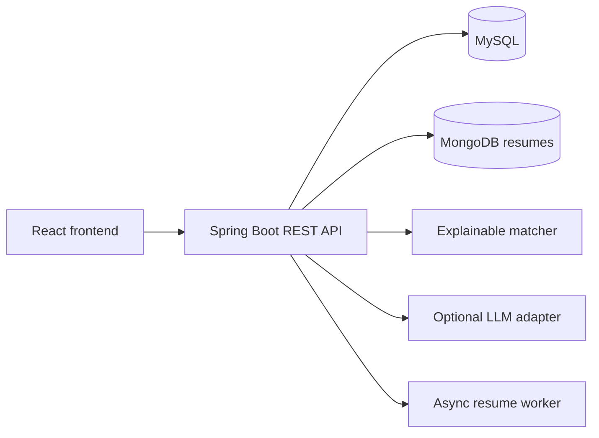

# JobLens Architecture

## System overview



## Data ownership

| Store | Data | Reason |
|---|---|---|
| MySQL | Users, profiles, jobs, saved jobs, applications | Relational integrity and transactional updates |
| MongoDB | Uploaded resume metadata, extracted text, structured profile | Flexible document shape and document-oriented access |
| In-memory worker queue | Resume processing tasks | Simple MVP asynchronous processing; replace with a durable queue at scale |

## Matching model

The current score is intentionally transparent:

```text
match score = 80% required-skill coverage + 20% general keyword overlap
```

The system reports matched skills, missing evidence, and resume excerpts. Missing a skill in the resume is not treated as proof that the candidate lacks the skill.

## Security decisions

- Passwords are stored as BCrypt hashes.
- JWTs authenticate API requests.
- User-owned resources are queried by authenticated email.
- Resume and application data are never fetched by an unscoped user query.
- Assistant responses are grounded in supplied resume/job context.
- Authentication and assistant routes have an in-memory rate limit.

## Known MVP limitations

- The resume worker is process-local; a durable queue is needed for multiple instances.
- Rate limiting is process-local; use Redis or an API gateway in production.
- Job ingestion currently uses seeded/demo data; production ingestion must use permitted sources.
- The optional LLM call requires an API key and should be protected by budget limits and observability.
